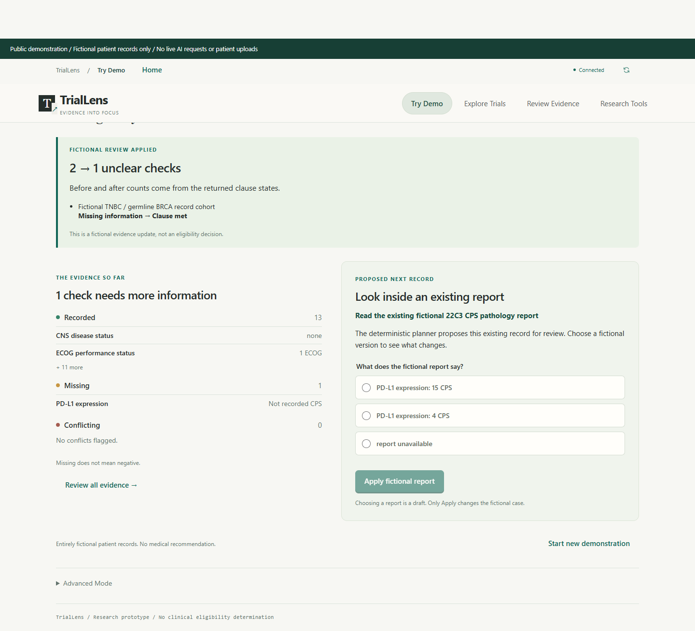
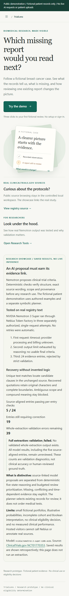

# TrialLens-TNBC

[Live demo](https://triallens-tnbc.onrender.com/) · [GitHub](https://github.com/chykoushik/TrialLens-TNBC)

A research prototype for reviewing missing, conflicting and time-dependent evidence in fictional triple-negative breast cancer (TNBC) trial scenarios. The demonstration runs locally without API credentials. This is not a validated clinical eligibility system, diagnostic tool or treatment recommendation service.

## Overview

Clinical criteria can depend on multiple records, assay details, timing and cohort-specific rules. TrialLens-TNBC makes these dependencies visible and asks which existing record to review next under a limited review budget. Missing evidence remains unresolved rather than being treated as a negative result.

## What TrialLens-TNBC does

The demo evaluates authored fictional evidence against fictional protocol clauses, prioritizes record reviews, and recomputes assessments after a user applies an authored fictional report outcome. It does not order tests, accept real patient uploads or establish trial eligibility.

There are two operating modes. **Offline mode is the default:** the browser uses deterministic fictional calculations without credentials. **Optional live mode** adds an authenticated operator HTTP workflow that sends the bundled fictional protocol to NVIDIA Nemotron on Nebius Token Factory. Live results are returned separately and never update the fictional cases. The browser demo has no provider-key input and does not initiate live inference.

The source also contains a controlled local workspace for registry browsing, strict extraction validation and annotation. Medical source files, provider responses and private annotations are not distributed; optional source views can be empty in a clean checkout. Selected research modules and aggregate results are included separately below.

## Key features

- Five explicit criterion states: satisfied, violated, unknown, temporal and conflict.
- Provenance, logical dependencies, temporal checks and budgeted review planning.
- Before/after explanations and backend-checked restoration of fictional browser sessions.
- Four fictional cases and predefined report outcomes, with no demo credentials.
- Source-grounded extraction validation that leaves unsupported proposals unreviewed.
- Optional, explicitly approved Nemotron inference with a persistent one-request limit.
- Registry retrieval and annotation routes remain unavailable on the public server.

## Application workflow

1. Open Home and select **Try the demo**.
2. Inspect the fictional evidence gaps and suggested record review.
3. Select an existing fictional report outcome. Selection alone does not apply it.
4. Select **Apply fictional report** to recompute clause states and remaining budget.
5. Read **What changed**, then inspect the next review or start a new demonstration.

Research Tools distinguishes failed model extraction from accepted source evidence. Registry links are context, not the source of the fictional patient's assessment.

## Research results and scope

The public application is a fictional demonstration with symbolic assessment and review planning. The separate research implementation evaluates probabilistic policies, compiled belief inference and interval certification. This repository includes its numerical core, independent synthetic tests and selected aggregate result snapshots. They do not change the demo or establish clinical eligibility accuracy.

The numerical modules use only the Python standard library:

- [Probabilistic model](research/decision_review_v1/model.py) and [constrained policy optimization](research/constrained_review_v1/solver.py), with the [analytical reference](research/constrained_review_v1/factorized.py).
- [Compiled belief inference](research/compiled_review_v1/belief.py) and [reusable belief caches](research/certified_review_v1/belief.py).
- [Continuous rational certification](research/certified_review_v1/certificate.py) and [abstention repair](research/certified_review_v1/policy.py).

The six numerical core files preserve the validated implementation. `research/synthetic.py` extracts the original deterministic case generators, and `policy.py` extracts the original repair function, without importing the experiment/report drivers. Tests compare inference against independent enumerated references, check constrained optima and verify the interior-risk counterexample. The rational certifier supports at most eight latent Boolean facts and only its specified observation law; it is not a general clinical uncertainty bound.

For research-only testing, use Python 3.12 and the pinned pytest dependency; no application packages, patient data, model weights or API credentials are required:

```powershell
python -m venv .venv
.\.venv\Scripts\python.exe -m pip install -r research/requirements.txt
.\.venv\Scripts\python.exe -B -m pytest research -q --basetemp=cache/pytest-research -p no:cacheprovider
```

These tests validate the numerical implementation and internal consistency of saved aggregates. They do not rerun the full historical benchmarks or reconstruct clinical inputs. METABRIC and pathology experiments cannot be reproduced fully from this checkout: patient-level inputs, source images, transcriptions, private adapters and the full experiment drivers are not included.

Completed studies support the following limited findings:

| Study | Verified result | Interpretation |
|---|---|---|
| Compiled inference | 96 successful matched reference comparisons agreed within 5.22e-15. Of 252 isolated benchmark runs, 159 succeeded, 84 were unsupported and nine timed out. | Exact substitution under the specified synthetic source model; not a general scalability or clinical accuracy result. |
| Continuous risk certification | In the final 24-instance synthetic study, certified policies had zero violations of the 0.08 expected protocol-error cap across 48 budget conditions; under severe model shift, 18 of 24 conditions violated the cap. The utility gain over the feasible baseline library was 0.002018, 95% CI [0.000321, 0.004368], Holm-adjusted p=0.07649. | Bounds depend on fixed priors, dependence assumptions and a common reliability multiplier in [0.65, 1.8]. The latest comparison does not establish superiority after multiplicity correction. |
| METABRIC archival rule proxies | Among 1,021 evaluation patients, nominal constrained planning, unconstrained planning and one/two-step lookahead tied at 0.3428% proxy error and 92.1156% decision coverage with a two-review budget. | No incremental risk-constraint advantage in this primary comparison. Authentic attributes and deterministic rule proxies are not clinician-verified eligibility labels. |
| Stricter risk limits | In a separate 256-patient study with simulated observation errors, a stricter nominal limit reduced proxy error from 2.7344% to 0.6548%, while coverage fell from 90.8854% to 70.4918% and utility from 0.977682 to 0.759691. The error difference had Holm-adjusted p=0.01897. | Lower all-case error came with increased abstention, including withheld correct decisions; it is not a cost-free safety gain. |
| Selection and coverage controls | Confidence-based primary coverage matching failed its requested-target criterion. A separate shared-MAP, outcome-blind quota control at 70% expected coverage gave 7.3230% proxy error for the strict-risk selectors versus 4.1563% for unconstrained and optimal fixed selection. | No established practical superiority of adaptive constrained selection. The quota control changes the decoder and does not inherit the native risk guarantee. |
| Authentic pathology sources | 1,075 TCGA-BRCA PDFs were obtained for 1,068 patients. Only three patients had two distinct records after alias review; none had verified longitudinal chronology. | Source acquisition and linkage do not establish a longitudinal clinical benchmark or complete eligibility ground truth. |

METABRIC contained 2,509 archival patients. The original three-field TNBC rule selected 320, including 51 with conflicting alternate ER evidence. Reconciliation yielded 269 concordant-by-available-evidence cases and 69 discordant potential TNBC cases. These are operational source categories, not adjudicated diagnoses. Observation probabilities and review costs in the planning experiments were assumed rather than clinically calibrated.

The extraction generalization study processed an internal holdout of **100 patients and 100 reports** outside documented review and tuning sets. Source-image review covered **24 patients**, yielding 92 research-transcribed facts. Only **eight patients contributed the 20 categorical ER/PR/HER2 reference findings** below. These transcriptions were not clinician-adjudicated, and the corpus had previously been bulk-processed.

| Automatic extraction method | Known source-supported findings recovered | Supported / accepted categorical assertions in the audited subset |
|---|---:|---:|
| Original | 11/20 | 21/30 (70.0%) |
| v1 | 20/20 | 39/53 (73.6%) |
| v2 context filtering | 20/20 | 39/50 (78.0%) |
| Joint ER/PR correction | 20/20 | 39/54 (72.2%) |
| Selective verification | 17/20 | 29/42 (69.0%) |

Context filtering removed three unsupported assertions without losing supported assertions in the audited subset. Joint correction passed all 44 software controls but added four unsupported definition spans on new cases. Selective verification withheld ten supported assertions. Patient-bootstrap precision intervals were wide: 65.9%-94.1% for v2 context filtering and 55.8%-94.1% for joint correction. Perfect recovery of 20 known findings is not whole-document recall or evidence of population-perfect performance. Image-assisted transcription results were evaluated separately and are not automatic OCR capability.

Selected snapshots retain their original study paths:

| Results | Published files and scope |
|---|---|
| [Compiled synthetic benchmark](results/recomb/20261026-compiled-review-v2) | `benchmark_summary.csv`, `paired_effects.csv`: isolated configuration timings and synthetic-seed paired effects. The original 96-condition study is separate from the later 48-condition certification study. |
| [Continuous certification](results/recomb/20261026-certified-review-v1) | `comparison.csv`, `paired_effects.csv`: final and out-of-model synthetic results only; development/validation rows are omitted from `comparison.csv`. Budgets within an instance are correlated. |
| [METABRIC primary comparison](research/metabric_realdata_v1/results/main_table.csv) | All four archival fields initially hidden, budget two, 1,021 evaluation patients and two shared-field rule proxies. Error and coverage use all proxy opportunities, not answered cases only. |
| [Risk and receptor reconciliation](research/metabric_risk_reconciliation_v1/results) | `cohort_transition.csv`, `budget_error_tradeoffs.csv`, `paired_statistics.csv`: cohort counts, assumed-channel tradeoffs and the complete 1,848-comparison Holm family. Highlighted grid examples remain exploratory. |
| [Confidence-based coverage comparison](research/matched_coverage_v1/results) | `primary_table.csv`, `primary_statistics.csv`: 48 planned contrasts including nine unattainable slots with missing test results. The failed requested-target matching gate is retained. |
| [Quota selection control](research/clinical_validation_v1/results) | `primary_operating_points.csv`, `primary_statistics.csv`: 60 contrasts on the same 1,021 evaluation patients, with a different shared-MAP/quota decoder. Integrated observation vectors and quota permutations are not extra patients. |
| [Extraction generalization](research/clinical_extraction_generalization_v1/results) | `method_metrics.csv`, `confidence_intervals.csv`, `withholding.csv`, `field_metrics.csv`, `component_transitions.csv`: limited reference recovery, audited precision, abstention and adverse joint-rule results with their separate denominators. |

The CSVs are saved aggregate evidence, not a new experiment or independently adjudicated clinical data. Integrity tests pin the snapshots and recompute the published Holm adjustments and consistency relationships. The retrospective Nemotron attempt shown in Research Showcase is a separate extraction-validation example, not these pathology benchmark results. The authentic pathology source inventory remains private.

Clinical eligibility remains unvalidated. Independent adjudication, dated patient-linked records, calibrated observation models, measured review effort and external validation are still required. Exact source offsets and passing software tests do not prove clinical interpretation or safety.

## Architecture and technology stack

```text
React 19 + TypeScript browser UI
             | same-origin /api
FastAPI: backend.public_demo:app
             |
Python criterion assessment, review planning and authored fixtures
```

Vite 7 builds the frontend. Vitest and Testing Library cover frontend behavior; pytest and FastAPI TestClient cover the backend; Playwright covers browser journeys. The public server serves the built UI and API on one origin. `backend.app.main:app` is the broader controlled workspace, not the public deployment entry point. Application extraction templates are required runtime code, not development-agent instructions.

The live router in `backend/app/public_live.py` reuses `nebius.py` for server-side HTTP and the existing extraction prompt and strict source validator. Its protocol text is bundled and explicitly synthetic. It requires no saved registry data, private modules, internal annotations or developer services. The upstream call is `POST https://api.tokenfactory.nebius.com/v1/chat/completions` with model `nvidia/nemotron-3-super-120b-a12b`; the supported regional base URL is `https://api.tokenfactory.us-central1.nebius.com/v1`. No local model weights or GPU are needed.

## Screenshots

Actual local application captures using fictional data:





## System requirements

- Python 3.12 and public package registry access during installation.
- Node.js 22.12 or later compatible with Vite 7, and npm. Local verification used Node 24 and npm 11; `package-lock.json` pins the frontend tree.
- Windows PowerShell and a modern browser. No GPU or model download is required for the fictional demo.
- Chrome or Edge for the supplied browser-test projects.

## Clone or download

Clone the public repository:

```powershell
git clone https://github.com/chykoushik/TrialLens-TNBC.git
Set-Location TrialLens-TNBC
```

Alternatively use GitHub **Code > Download ZIP**, extract it and open PowerShell in the extracted project directory.

## Backend installation and configuration

Run from the project root. Activation is optional because commands use the virtual environment interpreter directly:

```powershell
New-Item -ItemType Directory -Force cache | Out-Null
$env:TEMP = "$PWD/cache"
$env:TMP = "$PWD/cache"
$env:PIP_CACHE_DIR = "$PWD/cache/pip"
python -m venv .venv
.\.venv\Scripts\python.exe -m pip install -r requirements-demo.lock.txt
.\.venv\Scripts\python.exe -m pip check
```

The pinned file includes API and test dependencies. `requirements.txt` lists direct dependencies; use the lock file above for tested versions.

## Frontend installation and configuration

```powershell
npm.cmd --prefix frontend ci --cache "$PWD/cache/npm" --no-audit --no-fund
$env:VITE_PUBLIC_DEMO = '1'
$env:VITE_API_BASE_URL = '/api'
npm.cmd --prefix frontend run build
New-Item -ItemType Directory -Force frontend/dist/assets/licenses | Out-Null
Copy-Item third_party/licenses/*.txt frontend/dist/assets/licenses/
```

`VITE_*` variables are public build-time settings. Rebuild after changing them. Never put an API key into a `VITE_*` variable.

## Environment variables

`.env.example` has empty credential fields and safe example values. Neither the Python server nor Vite automatically loads it; Vite explicitly disables environment-file loading. Set process variables in PowerShell. Do not commit actual environment files or credentials.

| Variable | Safe value | Purpose |
|---|---|---|
| `VITE_PUBLIC_DEMO` | `1` | Restricts public frontend navigation. |
| `VITE_API_BASE_URL` | `/api` | Same-origin API path. |
| `TRIALLENS_API_TARGET` | `http://127.0.0.1:8000` | Vite development proxy target. |
| `PORT` | `8080` | Port for the optional `backend.serve_public` launcher. |
| `TRIALLENS_PUBLIC_DEMO` | `1` | Restricts the broader workspace; dedicated public server is independent. |
| `TRIALLENS_CORS_ORIGINS` | `http://localhost:5173,http://127.0.0.1:5173` | Broader workspace CORS. |
| `NEBIUS_API_KEY` | empty | Controlled integration only; leave unset for demo. |
| `NEBIUS_MODEL` | `nvidia/nemotron-3-super-120b-a12b` | Controlled integration model ID. |
| `NEBIUS_BASE_URL` | `https://api.tokenfactory.nebius.com/v1` | Controlled inference endpoint. |
| `NEBIUS_TIMEOUT_SECONDS` | `120` | Controlled request timeout. |
| `NEBIUS_LIVE_EXTRACTION` | `0` | Live extraction disabled. |
| `NEBIUS_INPUT_USD_PER_MILLION` / `NEBIUS_OUTPUT_USD_PER_MILLION` | empty | Optional declared pricing; no price assumed. |
| `TRIALLENS_LIVE_INFERENCE` | `0` | Additional opt-in for the public operator API. |
| `TRIALLENS_LIVE_OPERATOR_TOKEN` | empty | Separate operator authentication secret, 32-128 URL-safe characters; never reuse the Nebius key. |
| `TRIALLENS_LIVE_STATE_DIR` | empty | Absolute path to durable, writable reservation storage; required for live mode. |

## Start the backend and frontend

Serve the built public UI and backend together:

```powershell
.\.venv\Scripts\python.exe -B -m uvicorn backend.public_demo:app --host 127.0.0.1 --port 8080 --limit-concurrency 16 --no-access-log
```

For frontend development, use two terminals at the project root. Terminal one:

```powershell
.\.venv\Scripts\python.exe -B -m uvicorn backend.public_demo:app --host 127.0.0.1 --port 8000 --no-access-log
```

Terminal two:

```powershell
$env:VITE_PUBLIC_DEMO = '1'
$env:VITE_API_BASE_URL = '/api'
$env:TRIALLENS_API_TARGET = 'http://127.0.0.1:8000'
npm.cmd --prefix frontend run dev
```

The proxy removes `/api`; the public backend supports both prefixed and unprefixed demo routes. Stop servers with Ctrl+C.

For the optional controlled workspace, use `backend.app.main:app` on port 8000 and set `VITE_PUBLIC_DEMO='0'`. Keep it local, leave `NEBIUS_LIVE_EXTRACTION='0'` and expect missing source views. Its `/readiness` checks optional local source availability and can report missing private snapshots. Use the dedicated public server for the reproducible demo.

## Open and use the application

Open `http://127.0.0.1:8080` for the built application or `http://127.0.0.1:5173` for development. Check connectivity:

```powershell
Invoke-RestMethod http://127.0.0.1:8080/api/health
Invoke-RestMethod http://127.0.0.1:8080/api/readiness
```

In default mode, public health reports `paid_inference: false`. In optional live mode this flag reports that the operator API is enabled, not that a provider call has occurred or succeeded. Health, readiness and preview requests never trigger inference. Public readiness requires the fictional cases and built frontend. Browser storage contains fictional demonstration state only.

## Optional live NVIDIA Nemotron inference

Use this mode only if you intend to authorize a potentially billable provider request. It is an operator-only API workflow, not a browser button or a replacement for the fictional demonstration. The only accepted input is bundled `fictional-protocol-v1`; its `NCT00000000` is a synthetic placeholder, not a registry study. Arbitrary text, patient records and local file paths are not accepted.

After installation and the frontend build, configure the **server terminal** from the release root. Read secrets privately; do not paste them into source files or command literals:

```powershell
$providerSecret = Read-Host 'Nebius API key (server only)' -AsSecureString
$env:NEBIUS_API_KEY = [System.Net.NetworkCredential]::new('', $providerSecret).Password
$operatorSecret = Read-Host 'Separate operator token, 32-128 URL-safe characters' -AsSecureString
$env:TRIALLENS_LIVE_OPERATOR_TOKEN = [System.Net.NetworkCredential]::new('', $operatorSecret).Password
$env:NEBIUS_MODEL = 'nvidia/nemotron-3-super-120b-a12b'
$env:NEBIUS_BASE_URL = 'https://api.tokenfactory.nebius.com/v1'
$env:NEBIUS_TIMEOUT_SECONDS = '120'
$env:TRIALLENS_LIVE_STATE_DIR = "$PWD/cache/public-live-state"
New-Item -ItemType Directory -Force $env:TRIALLENS_LIVE_STATE_DIR | Out-Null
$env:TRIALLENS_LIVE_INFERENCE = '1'
$env:NEBIUS_LIVE_EXTRACTION = '1'
.\.venv\Scripts\python.exe -B -m uvicorn backend.public_demo:app --host 127.0.0.1 --port 8080 --limit-concurrency 16 --no-access-log
```

Both enable flags, server-side provider configuration, a separate operator token and a valid storage path are required. Keep `VITE_PUBLIC_DEMO=1`; do not put either secret in a `VITE_*` variable or browser storage. `TRIALLENS_PUBLIC_DEMO` does not enable this new API. A provider key alone cannot send a request. The offline browser remains available at the same address.

In a **second operator terminal**, supply only the separate operator token, not the Nebius key. Use the assigned HTTPS origin for hosting; the loopback HTTP address below is for local testing:

```powershell
$baseUrl = 'http://127.0.0.1:8080'
$operatorSecret = Read-Host 'Operator token for this server' -AsSecureString
$headers = @{ Authorization = 'Bearer ' + [System.Net.NetworkCredential]::new('', $operatorSecret).Password }
$preview = Invoke-RestMethod "$baseUrl/api/inference/prepare" -Method Post -Headers $headers -ContentType 'application/json' -Body '{"source_id":"fictional-protocol-v1"}'
$preview | Select-Object model, max_output_tokens, timeout_seconds, source, expires_at, charge_warning | Format-List
```

Preparation sends **no provider request**. Review the exact synthetic source, source hash, model, output cap and charge warning. Signed approval expires after five minutes and is bound to the request and server configuration. The next block can incur charges and is intentionally separate:

```powershell
$confirmation = Read-Host 'Type APPROVE ONE PAID REQUEST to authorize this preview'
if ($confirmation -cne 'APPROVE ONE PAID REQUEST') { throw 'Not approved; no provider request sent' }
$body = @{ approval = $preview.approval; confirm_paid_request = $true } | ConvertTo-Json
$result = Invoke-RestMethod "$baseUrl/api/inference/execute" -Method Post -Headers $headers -ContentType 'application/json' -Body $body
$result | ConvertTo-Json -Depth 30
Remove-Variable headers, operatorSecret -ErrorAction SilentlyContinue
```

`GET /api/inference/status` requires the same operator authorization and never calls the provider. The API returns 404 when disabled, 401 for invalid operator authorization, 503 for unavailable configuration/storage, and 409 for invalid/expired approval or a consumed reservation. Missing or non-boolean paid confirmation is rejected before any reservation or request.

Exactly **one provider attempt is permitted per persistent state directory**, using an atomic `request.claim` file across workers. Reservation is recorded before HTTP dispatch. Provider errors, timeouts and invalid model output do not release it: processing/billing can be uncertain after timeout. There are no automatic retries, reset endpoints, alternate-model substitutions or live-to-mock fallback. Do not clear, replace or restore older reservation storage to retry. Any later increase in allowance requires a separate explicit operator decision and billing review. This is not an account-wide spending cap across unrelated tools or installations.

Output is capped at 8,192 tokens with a timeout at most 120 seconds. The reused client's model-specific reasoning control still requires provider-side compatibility verification. No successful real provider call is claimed by mocked tests. A completed response must pass the existing structural and exact-source validator; otherwise the API returns `validation_failed` with no proposal. A `source_validated` proposal remains unreviewed, requires qualified human review and has `assessment_allowed: false`. Source validation is not clinical validation. Raw provider responses are not stored or returned; credential echoes are withheld. Live output is never applied to the fictional demonstration.

## Available fictional demonstration data

Four cases are included: **Complete fictional records**, **Missing assay-matched records**, **Stale laboratory observation** and **Conflicting performance records**. Two fictional protocol examples illustrate PD-L1 and germline BRCA record cohorts. All are synthetic.

Frontend fixtures are in `frontend/src/fixtures/`; backend cases are constructed in `backend/app/tnbc_demo.py`. Backend fixtures are software test data, not clinical reference labels. No real patient records are included.

## Testing

Build the public frontend first, then run:

```powershell
.\.venv\Scripts\python.exe -B -m pytest backend/tests -q --basetemp=cache/pytest-public -o cache_dir=cache/pytest-public-cache
$env:VITE_PUBLIC_DEMO = '0'
npm.cmd --prefix frontend test
```

Frontend tests exercise both controlled and demo components with mocked responses. Tests requiring optional private saved-source integration data are explicitly skipped in a clean checkout. Provider unit tests use synthetic values and mocked transports, never paid inference.

Targeted public live-inference tests also run without credentials, network access or charges:

```powershell
.\.venv\Scripts\python.exe -B -m pytest backend/tests/test_public_live.py backend/tests/test_public_release.py backend/tests/test_public_submission.py -q --basetemp=cache/pytest-live -o cache_dir=cache/pytest-live-cache
```

They verify approval, authentication, missing configuration, one atomic reservation under concurrent requests, sanitized provider failures/timeouts, credential-echo blocking and strict output validation. No successful live provider call is implied by passing mocks.

For the existing public browser journey, keep the built public server running on port 8080 and run in another terminal:

```powershell
$env:VITE_PUBLIC_DEMO = '1'
$env:DROPDOWN_BASE_URL = 'http://127.0.0.1:8080'
$env:DROPDOWN_EXTERNAL_SERVER = '1'
$env:DROPDOWN_RUN = 'local-public-check'
npm.cmd --prefix frontend run test:browser -- e2e/public-submission.spec.mjs --project=chrome
```

This checks real API-backed fictional review, session handling, keyboard use, responsive layout and blocked private routes. Outputs stay ignored. `python scripts/public_release.py` checks the public inventory and writes an ignored JSON inventory under `cache/`, without staging Git changes.

## Deployment information

The public demo is hosted at https://triallens-tnbc.onrender.com/. `Dockerfile` and `render.yaml` define a Node build stage, Python 3.12 runtime, non-root user and `PORT` configuration. Render checks `/api/readiness`, which returns HTTP 503 if the fictional cases or built frontend are unavailable; `/api/health` remains a liveness endpoint. The blueprint disables auto-deploy. The container launcher is `python -B -m backend.serve_public`.

The hosted service passed HTTP health and readiness checks on 28 October 2026 with paid inference disabled. Those checks establish availability at that time, not clinical validity, successful provider inference or verification of a particular deployed commit. Local tests and builds do not deploy the service.

The default Render blueprint leaves both live enable flags at `0` and needs no persistent application data. For optional live mode, use one service instance with a [Render persistent disk](https://render.com/docs/disks), available on paid services. Mount durable storage, for example at `/var/data`, and set `TRIALLENS_LIVE_STATE_DIR` to a writable directory on that disk. Ensure Docker UID 10001 can create and retain the reservation file there; unwritable storage fails closed before inference. Set the Nebius key and separate operator token privately in the hosting dashboard, configure the model/base URL, then explicitly set both enable flags to `1`. Keep both secrets out of `render.yaml`, the frontend build and logs. Keep the existing public entry point; do not expose the broader controlled app to enable this feature.

Do not enable paid inference with ephemeral reservation storage, multiple independent state directories or independently scaled replicas. Restarts/redeploys must preserve `request.claim`; otherwise a one-request limit would reset. The free offline blueprint is not a persistent live-inference configuration. Docker/Linux disk permissions, the hosted endpoint and real provider behavior still need owner verification; no hosting resources are provisioned here.

## Limitations and research prototype disclaimer

Authored probabilities, costs and examples do not establish clinical calibration, benefit or safety. Missing, conflicting and stale evidence must not be converted into unsupported eligibility assertions. No diagnosis or treatment recommendation is provided.

The controlled NVIDIA Nemotron / Nebius integration produced saved attempts, including structured output rejected by validation. The public showcase retains that failed status and human-review requirement; it is not a clinical accuracy benchmark. The new optional operator API performs genuine inference only when explicitly executed and configured; its mocked tests are not live-provider verification. Model proposals require source validation and qualified human review. The offline browser demo always uses deterministic calculations and never substitutes model output.

## License and attribution

The project-owned source code in this repository is licensed under the Mozilla Public License, version 2.0 (MPL-2.0); see `LICENSE` for the complete text. Third-party materials retain their own terms. Software tests do not establish copyright ownership or contributor permissions; those remain the responsibility of the contributors and repository owner.

The public source is available at https://github.com/chykoushik/TrialLens-TNBC and linked from the application footer. When distributing compiled frontend code or a container, retain the license notices and identify the corresponding source revision.

Third-party terms remain in `THIRD_PARTY_NOTICES.txt` and `third_party/licenses/`. Preserve React, React DOM, Scheduler, Vite and installed Python notices. NVIDIA model and Nebius service terms are separate; no weights, credentials or raw model responses are distributed. Registry attribution remains ClinicalTrials.gov / U.S. National Library of Medicine. No sponsor endorsement is implied.

The optional operator API supports a configured Token Factory request, but the offline browser demo and mocked tests do not establish successful live provider execution. Integration code and saved attempts are not clinical validation or evidence of a deployed Nebius application.
